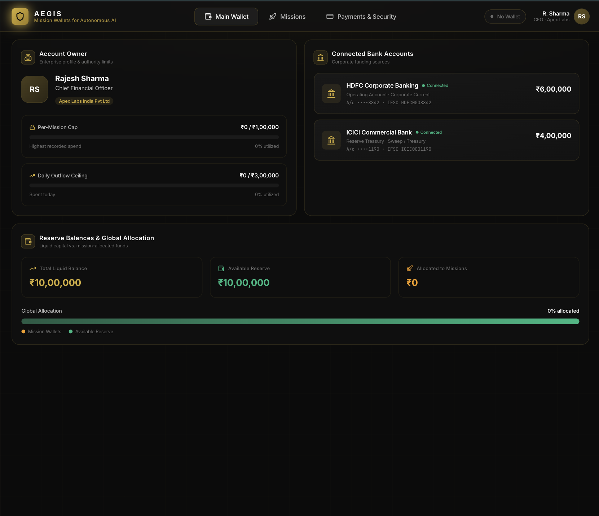
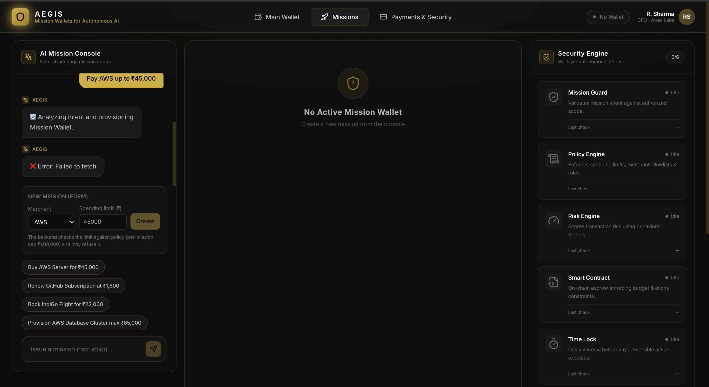
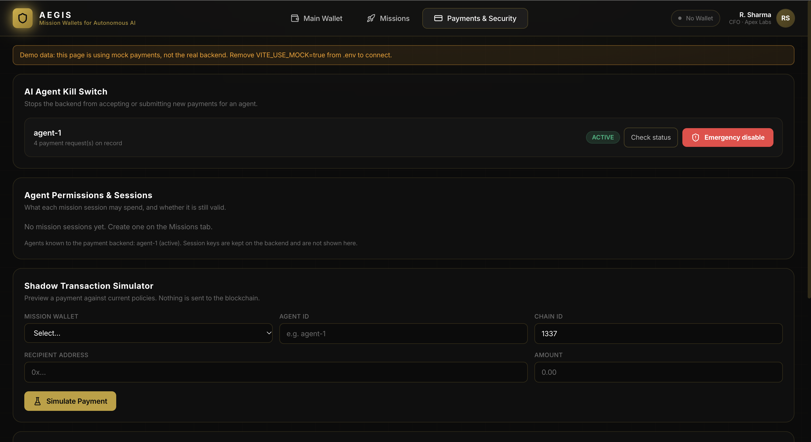
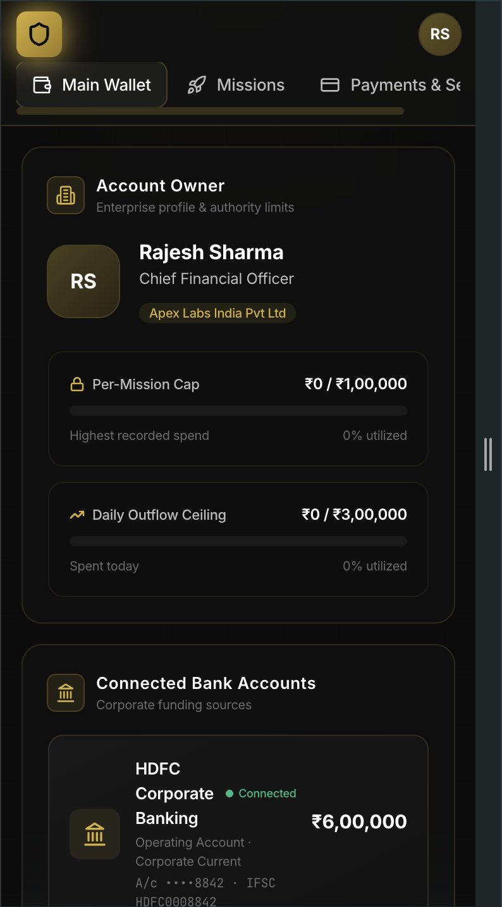
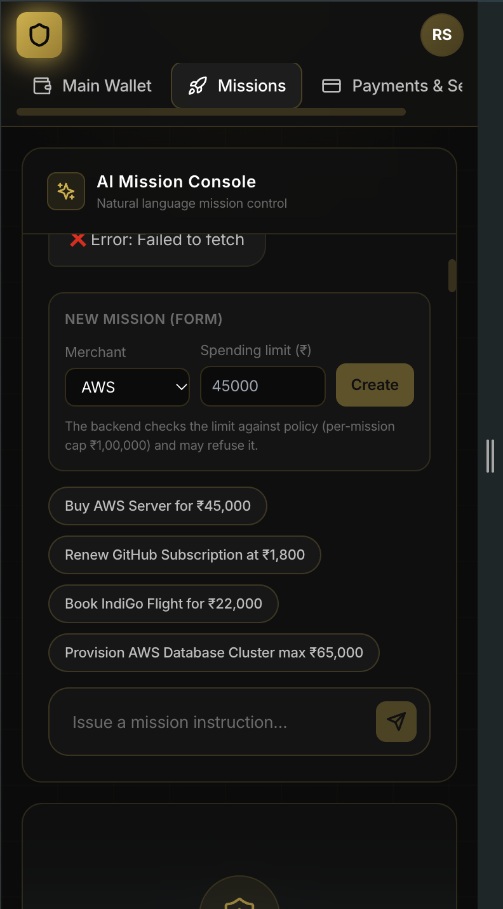
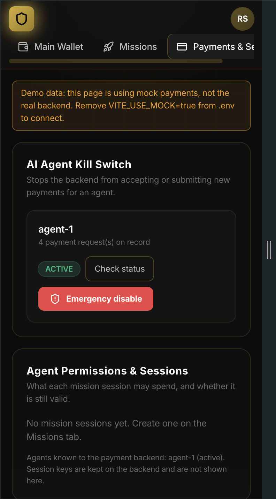

# AEGIS Frontend – UI documentation (Person 3)

## Run it
    npm install
    cp .env.example .env.local  # set VITE_USE_MOCK=true to work without the backend
    npm run dev               # http://localhost:5173
    npm run typecheck
    npm test                  # logic and API-client tests (node:test via tsx)

## Screens
| Tab | What it shows | Data source |
|---|---|---|
| Main Wallet | Account owner, limits, bank accounts, reserve vs allocated balances, spending history | Socket state from backend |
| Missions | Mission form + AI console, mission wallet cards (budget, expiry, status), security engine, live terminal | `/api/missions/*`, socket |
| Payments & Security | Access token, kill switch, agent permissions/sessions, simulator, payment queue and history | `/api/payments/*` |

### Screenshots (1280 px desktop)

**Main Wallet**

**Missions** (the red "Failed to fetch" message appears when the backend is not running)

**Payments & Security** (shown with `VITE_USE_MOCK=true`, so it uses demo data)

### Screenshots (375 px phone)

| Main Wallet | Missions | Payments & Security |
|---|---|---|
|  |  |  |

## Responsive behaviour
Checked in Chrome device mode at 375, 768 and 1280 px on all three tabs: no page-wide sideways scrolling, no clipped text and no unreachable buttons.
- The tab bar scrolls sideways inside its own row on phones (the last tab is partly hidden until you swipe).
- Wide tables (payment history, agent sessions) scroll inside their own box.
- Card grids in the mission wallet stack into one column on phones and use two columns from 640 px.
- The mission console is 70% of the screen height on phones and full height from 1024 px.

## Mock mode vs real backend
- `VITE_USE_MOCK=true` fakes only the **Payments & Security** data (agent-1 and sample payments).
- The Main Wallet and Missions tabs use a live socket connection to `VITE_BACKEND_URL` (default `http://localhost:5000`). Without a backend they show empty states, the browser console shows socket connection errors, and creating a mission shows "Failed to fetch". This is expected.
- On macOS, port 5000 may be taken by AirPlay Receiver (it answers with HTTP 403). If so, run the backend on another port and set `VITE_BACKEND_URL` to match.

## Payments & Security details
- **Access token**: the payment API needs `Authorization: Bearer <token>`. The backend uses static shared role tokens (not user accounts). Paste one into the page; it is kept in this tab's sessionStorage, never in `.env` or the built code, and must never be logged or committed. Demo only; production needs a real login. Which token each action needs:

  | Role token | Actions |
  |---|---|
  | reader | list payments, view one payment, agent status, simulate |
  | operator | create a payment, simulate |
  | approver | approve, reject, freeze, unfreeze, freeze/unfreeze a mission |
  | executor | execute, reconcile |
  | admin | kill (emergency disable) an agent, agent status |

  If an action is refused with "Your token is not allowed", save the token for the right role and try again.
- **Kill switch**: calls `POST /api/payments/agents/:id/kill` (admin token). Agents are listed from the payments the backend returns, plus any agent ID you type in with "Add agent". Status shows UNKNOWN until you press "Check status" (reader or admin token), because the backend has no agent-list route yet. The backend stops accepting payments for that agent. The UI shows the backend's on-chain revocation result honestly (currently "not performed"). Already-submitted transactions are listed because they may still complete. Status is re-read from the backend after every action.
- **Simulator**: `POST /api/payments/simulate` returns a preview only (`broadcasted: false`). "Proceed to approval" creates a PENDING payment with a fresh idempotency key per attempt; a retry returns the existing payment. The page only checks input *format*; every policy decision is the backend's.
- **Queue and history**: filters (status, mission, date) are applied in the browser because the backend returns all payments. Actions offered per status mirror the backend transition table: PENDING (approve/reject/freeze), APPROVED (execute/reject/freeze), FROZEN (unfreeze/reject), SUBMITTED (check chain only). Approve first fetches the payment's `detailsHash` so approval is bound to exact details.
- **Execute** is refused by the backend while `EXECUTION_MODE=demo`; the refusal message is shown as-is.
- **Rate limit**: the backend allows 100 requests per 15 minutes per IP, so the page does not auto-poll. Use Refresh.

## Known limits
- No agent-list route on the backend yet (pending Person 2). The Kill Switch builds its list from payments and from agent IDs typed in by hand; statuses are only known after "Check status".
- Session keys are no longer returned by the backend, so the key chip on mission cards shows "None".
- No transaction-explorer links: the backend does not return a verified explorer URL.
- Mission creation sends a sentence (`Pay <merchant> up to ₹<amount>`) to `POST /api/missions/create`, which only accepts `{ text }`. That route does not use the role-token check, so it is not production-grade authentication.
- Daily limit, per-transaction limit, allowlist and custom expiry cannot be set from the UI; the backend does not accept them yet (needs a decision with Person 2).
- Real-chain execution is disabled on the backend until its contract adapter is ready, so Execute is refused.
